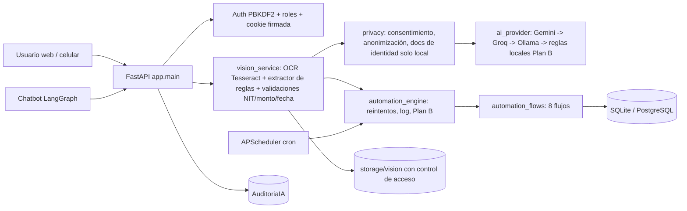

# Arquitectura

## Capas
- **Presentación**: plantillas Jinja2 + Bootstrap (`/vision`, `/automatizacion/flujos`, tickets, dashboard).
- **API**: FastAPI con sesión por cookie `HttpOnly`/`SameSite`, roles Agente y Administrador.
- **Motor de automatización**: `automation_engine.py` (ejecución, reintentos con backoff, estados, logs), `automation_flows.py` (registro `FLUJOS`), `scheduler.py` (APScheduler, zona America/Bogotá, un solo worker).
- **IA**: `llm_chains.py` (LangChain: prompt | modelo | parser con fallbacks), `chatbot_graph.py` (LangGraph, nodos recuperar → responder, memoria por usuario con `MemorySaver`), `ai_provider.py` (cadena de proveedores, cuota 429 → siguiente).
- **Visión**: `vision_service.py`, caso de uso *lectura de facturas/recibos* (+ capturas de error y documentos de identidad).
- **Datos**: SQLAlchemy; tablas nuevas `tbl_gasto` y `tbl_auditoria_ia` creadas con `create_all`.

## Plan B ante fallos del modelo
1. Cuota/falla de Gemini → Groq → Ollama (si `OLLAMA_BASE_URL`) → reglas locales.
2. Visión sin modelo ni OCR → estado `sin_lectura` y revisión humana (nunca se inventan datos).
3. Documento sin proveedor disponible → `COLA_REINTENTO`, reprocesado por el cron.

## Despliegue
`Dockerfile` (Python 3.12 + Tesseract spa) y `render.yaml` (Render, plan gratuito, health check `/health`). Variables en `.env.example`.
